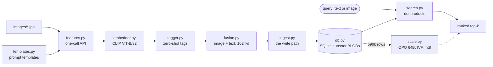

# clip-vlm-101

**Search a photo gallery by meaning — type "a fluffy animal", get the cat — using a CLIP pipeline small enough to read in one sitting.**

[](.github/workflows/test.yml)
[](LICENSE)
[](test_smoke.py)
[](https://sugeerth.github.io/clip-vlm-101/)

**Live demo → [sugeerth.github.io/clip-vlm-101](https://sugeerth.github.io/clip-vlm-101/)**
Real CLIP inference in the tab via [transformers.js](https://huggingface.co/docs/transformers.js).
No install, no API key, and nothing you type or upload leaves your machine.
It answers on the first keystroke: a precomputed word lexicon (`docs/lexicon.json`, built by
`build_lexicon.mjs`) ranks the gallery while the model downloads, then CLIP takes over from a
Web Worker. Hermes, the web crawl and the judges live on [the full demo](https://sugeerth.github.io/clip-vlm-101/full.html).

> Vector search is usually taken on faith: an embedding model you did not write, an
> index you cannot inspect, and a ranked list with no way to ask *why*. This repo
> opens every step — the 512 floats an image becomes, the single dot product that
> ranks it, and precisely how much recall you lose compressing that vector from
> 2,048 bytes to 64. The core is eight files and 592 lines; everything past that is
> an optional chapter.

---

## Quickstart

`docs/db.json` ships the real CLIP embeddings of the 14 sample images, so the math
runs on committed data — **no torch, no model download, no network**.

```bash
git clone https://github.com/sugeerth/clip-vlm-101 && cd clip-vlm-101
pip install numpy pillow    # numpy does the math; pillow is for one crawler test

python3 similarity.py --json docs/db.json      # the modality gap, measured
python3 test_smoke.py                          # 40 tests, ~2 seconds
```

Tail of the first command, verbatim:

```text
the modality gap — mean similarities:
  image · other images     +0.569  #######################
  text · other texts       +0.726  #############################
  image · OWN caption      +0.293  ############
  image · other captions   +0.173  #######
```

An image sits ~2x closer to *other images* than to its own caption — which is why
`search.py` never mixes the two scales in one ranking.

Prefer the browser? `python3 -m http.server -d docs 8000` serves the same demo
locally at `http://localhost:8000`.

### The real pipeline (needs torch)

```bash
python3 -m venv .venv && .venv/bin/pip install -r requirements.txt

.venv/bin/python download_samples.py               # 14 Wikimedia samples → images/
.venv/bin/python ingest.py images/*.jpg            # embed + auto-tag + write SQLite
.venv/bin/python search.py "a fluffy animal"       # search by text
.venv/bin/python search.py --image images/cat.jpg  # search by image
```

Budget ~1.6 GB of disk, measured with `du` on this machine: the venv comes to 981 MB
(torch alone is 529 MB), and the first run pulls the 577 MB
`openai/clip-vit-base-patch32` checkpoint into `~/.cache/huggingface`. Device
auto-detects CUDA → Apple Silicon MPS → CPU (`embedder.best_device`).

---

## How it works



Both CLIP towers project into the **same** 512-d space, so a photo of a cat and the
sentence "a photo of a cat" land near each other. Every operation here — tagging,
captioning, retrieval — is cosine similarity between unit vectors, i.e. one dot product.

- `embedder.py` turns images **and** text into unit vectors from one registered model.
- `tagger.py` scores the image against a prompted vocabulary and argsorts — zero training.
- `fusion.py` concatenates the two towers as `[image ; text] / √2`, still unit-length.
- `ingest.py` is the write path: one image in, one database row out.
- `db.py` stores all three vectors as float32 BLOBs in plain SQLite.
- `search.py` ranks by text, image, or fused similarity (`--image` always scores
  image-to-image, so the two scales above never meet in one ranking).
- `scale.py` runs the identical design over 690k real vectors, where the *layout* — not
  the math — is what has to change.

Read them in that order; every file's docstring carries a `pipeline:` line showing
where it sits.

---

## Results

Compression vs. accuracy at **690,000 real vectors** (Qdrant's public Wolt food
dataset, same ViT-B/32 checkpoint). recall@k is measured against the exact top-k on
self-queries — the hardest case a compressed index faces. Produced by
`python3 scale.py bench`; the table is committed in
[`docs/scale.html`](https://sugeerth.github.io/clip-vlm-101/scale.html) and
[`guide/06-a-million-rows.md`](guide/06-a-million-rows.md).

| method | bytes/vec | recall@1 | recall@10 | recall@100 |
|---|---|---|---|---|
| brute force, f32 (the truth) | 2048 | 1.00 | 1.00 | 1.00 |
| int8, per-dimension | 512 | 0.60 | 0.86 | 0.93 |
| int8 → exact re-rank | 512 | 0.66 | 0.91 | 0.93 |
| OPQ, coarse | **64** | 0.62 | 0.59 | 0.62 |
| **OPQ → exact re-rank** | **64** | 0.68 | **0.92** | 0.92 |

The bottom row is the headline: **64 bytes a vector, 32x smaller than float32, and
recall@10 of 0.92.** Coarse codes are a filter, not an answer; a short exact re-rank of
their shortlist recovers the truth.

Latency for exact search, median per query on one laptop, same 690k corpus:

| where the bytes live | ms / query | recall@10 |
|---|---|---|
| f16 memmap, paged off disk | 110 | 1.00 |
| f32 in RAM (`scale.py serve`) | 18.6 | 1.00 |
| f32 on GPU / MPS (`scale.py serve`) | 12.3 | 1.00 |

Same algorithm, an order of magnitude apart — the win came from moving the bytes.

---

## Repo map

| path | what it is |
|---|---|
| [`guide/`](guide/README.md) | **start here after the quickstart** — 9 chapters, each runnable |
| `features.py` | the one-call API: `fx.extract("photo.jpg")` → tags, caption, all three vectors |
| `templates.py`, `embedder.py`, `tagger.py`, `fusion.py`, `db.py`, `ingest.py`, `search.py` | the other seven files of the 592-line core |
| `scale.py` | the 690k engine — `ingest`, `search`, `bench`, `serve`, `selftest` |
| `opq.py`, `pq.py` | product quantization to 64 bytes/vector — the learned rotation, and the browser twin. IVF (`ivf_train`/`ivf_search`) and per-dimension int8 (`build_i8`) live inside `scale.py`; 1-bit binary (`binary_encode`) inside `cascade.py` |
| `judge.py`, `conformal.py`, `trust.py`, `drift.py` | the evaluation layer: judges, coverage guarantees, drift gates |
| `docs/` | the GitHub Pages demo (`main:/docs`) + 12 JS twin test suites |
| `test_smoke.py` | 40 model-free tests; stubs the CLIP encoder so CI never installs torch |
| [`ARCHITECTURE.md`](ARCHITECTURE.md) | the four stages of billion-scale visual search, and which file shows each |

CI ([`.github/workflows/test.yml`](.github/workflows/test.yml)) runs the smoke suite,
12 Node twin suites that pin the browser JS to the Python math, and 21 model-free CLI
demos on the committed gallery — on numpy and pillow alone.

---

## Limitations / what this is not

- **A teaching repo, not a production vector database.** No sharding, no replication,
  no write path under concurrency. Read it for the ideas, not to deploy it.
- **The recall numbers are self-queries, not a labelled benchmark.** That is the
  strictest test for a compressed index, but it is not MS MARCO or BEIR, and it says
  nothing about semantic relevance judged by a human.
- **The 690k corpus and its built indexes are gitignored** — about 9 GB on disk here:
  7.4 GB of source parquet in 35 parts, plus ~1.7 GB of packed f16/int8/OPQ matrices
  and a 275 MB `scale.sqlite`. CI covers the same machinery on synthetic vectors via
  `scale.py selftest`; to reproduce the table you must ingest the dataset yourself.
- **The "LLM judges" in the CLI are model-free rubrics.** Only the browser demo runs an
  actual small LM (SmolLM2-135M). Do not read `judge.py` as a benchmark of LLM-as-judge.
- **CLIP ViT-B/32 is a 2021 checkpoint** and nothing here is fine-tuned. Newer encoders
  drop into `embedder.py`'s registry, but the numbers on this page are that model's.

---

## Credits

Sample photos come from [Wikimedia Commons](https://commons.wikimedia.org) (freely
licensed; each file's Commons page has the details). The model is
[openai/clip-vit-base-patch32](https://huggingface.co/openai/clip-vit-base-patch32).
The 690k corpus is [Qdrant's Wolt food embeddings](https://huggingface.co/datasets/Qdrant/wolt-food-clip-ViT-B-32-embeddings).

---

## License

[MIT](LICENSE) — take it, fork it, rebuild it with your own images.
